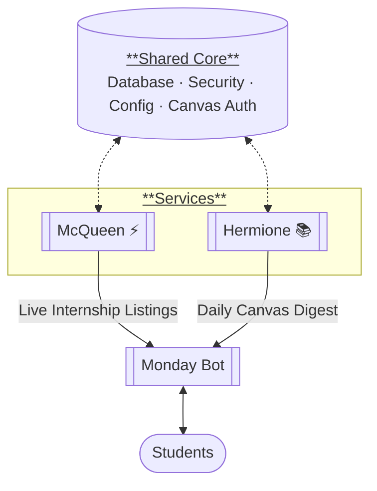

# monday 
Monday is a <u>**Telegram-based personal assistant for NUS computing students**</u>.

University life is scattered across apps. Coursework lives on Canvas, internship opportunities on LinkedIn, and emails in Outlook, etc. Staying on top of everything means constantly checking each platform and hoping you don't miss anything important.

Monday brings the updates that matter **straight to your Telegram chat, <u>automatically</u>.** No commands to remember, no apps to keep checking, and no important updates left buried in another platform. Just one chat that keeps you in the loop, so you never have to go looking.

## Services

Monday offers various sub-services, each with its own distinct functionality. Pick your services once in the bot, and Monday handles the rest.

| Service | What it does |
|---|---|
| **McQueen ⚡** | <ins>**Live Alerts**</ins> for SG Computing Internship Listings|
| **Hermione 📚** | <ins>**Daily**</ins> Canvas reminders for Upcoming Assignments and Quizzes |

## Overall Architecture

